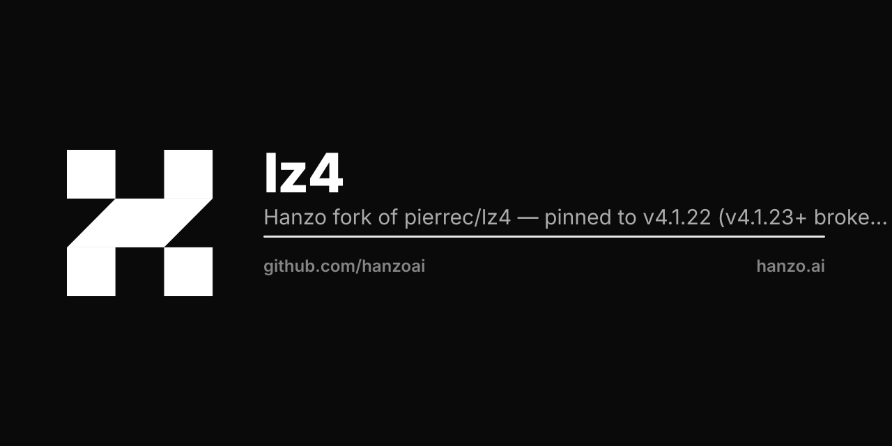

<p align="center"></p>

# lz4 : LZ4 compression in pure Go

[](https://pkg.go.dev/hanzo.ai/lz4/v4)

## Overview

This package provides a streaming interface to [LZ4 data streams](http://fastcompression.blogspot.fr/2013/04/lz4-streaming-format-final.html) as well as low level compress and uncompress functions for LZ4 data blocks.
The implementation is based on the reference C [one](https://github.com/lz4/lz4).

## Install

Assuming you have the go toolchain installed:

```
go get hanzo.ai/lz4/v4
```

This module provides the `lz4` library only. It does **not** ship a command-line
tool; if you need one, use the upstream `lz4c` from `github.com/pierrec/lz4/v4`.

## Example

```
// Compress and uncompress an input string.
s := "hello world"
r := strings.NewReader(s)

// The pipe will uncompress the data from the writer.
pr, pw := io.Pipe()
zw := lz4.NewWriter(pw)
zr := lz4.NewReader(pr)

go func() {
	// Compress the input string.
	_, _ = io.Copy(zw, r)
	_ = zw.Close() // Make sure the writer is closed
	_ = pw.Close() // Terminate the pipe
}()

_, _ = io.Copy(os.Stdout, zr)

// Output:
// hello world
```

## Contributing

Contributions are very welcome for bug fixing, performance improvements...!

- Open an issue with a proper description
- Send a pull request with appropriate test case(s)
